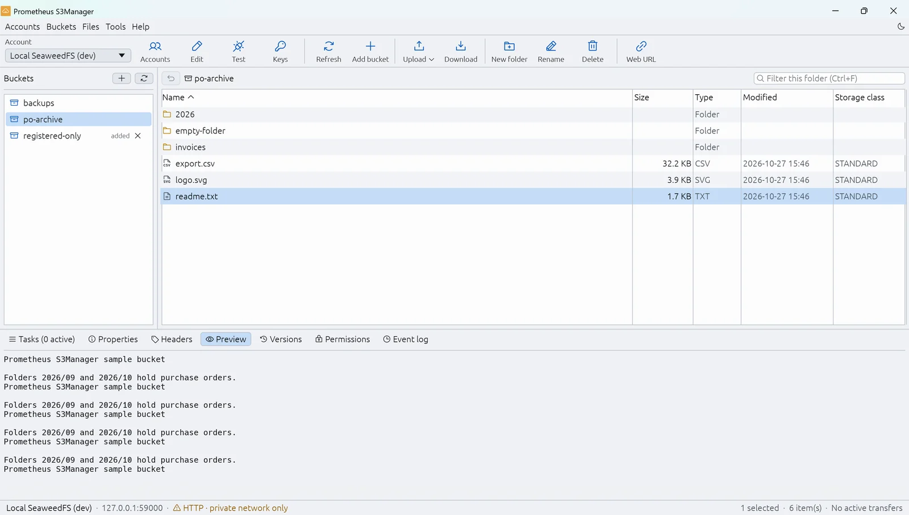
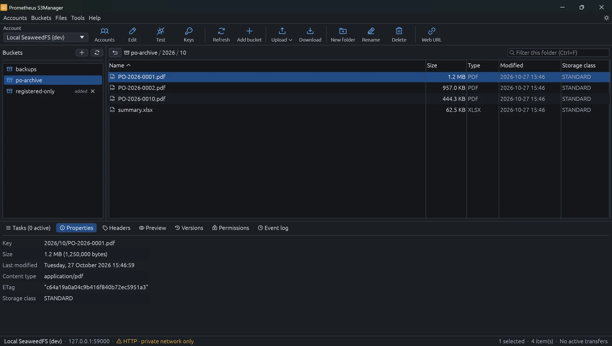
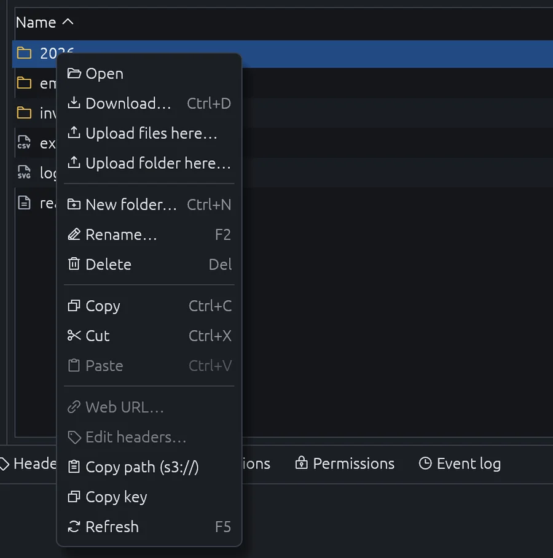
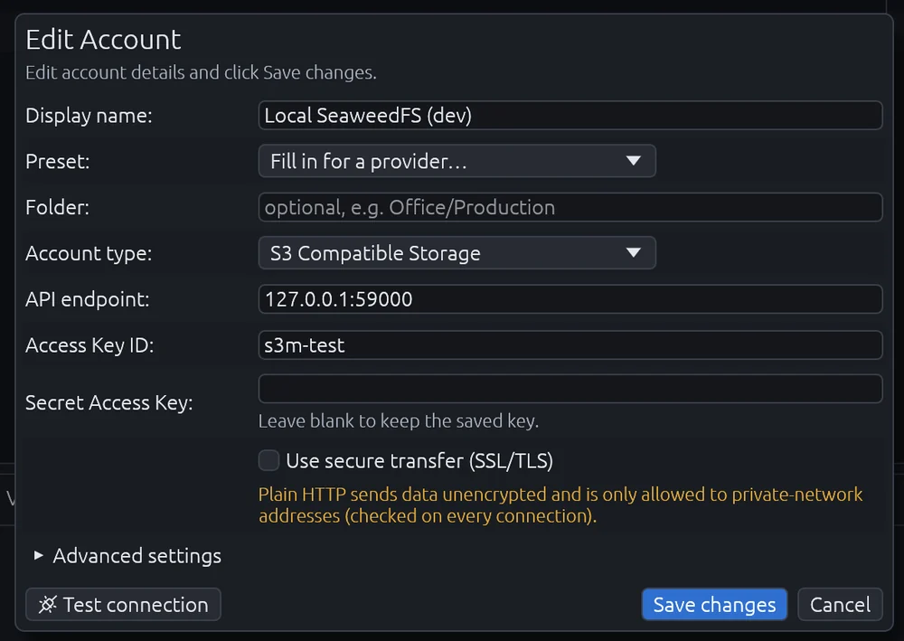

# Prometheus S3Manager

Desktop file manager for Amazon S3 and S3-compatible storage (MinIO, Cloudflare R2, Wasabi,
Backblaze B2, DigitalOcean Spaces, Ceph, SeaweedFS, ...). Native Windows app written in Rust.



The screenshots show sample data on a local test server (`examples/seed_dev.rs`); the account,
buckets and files are not real.

## Features

- **Accounts**: any number of accounts and keys, folders, provider presets, test connection,
  import/export with a password. Secret keys are stored in the Windows Credential Manager, optionally
  protected by a master password.
- **Secure connections**: TLS with the Windows certificate store (company CAs work) and an optional
  custom CA per account. Plain HTTP only for private-network addresses.
- **Files**: browse, filter and sort; upload files and folders (drag and drop from Explorer),
  download, rename, delete, new folder, copy/cut/paste between folders, buckets and accounts.
- **Transfers**: queue with retry, pause/resume (also after a restart), multipart uploads,
  bandwidth limit, speed and time left.
- **Objects**: properties, headers and metadata editor, preview of text and images, versions
  (download, restore, delete), permissions (ACL), presigned web URLs.
- **Buckets**: create, delete, properties, and settings for versioning, encryption, policy, CORS,
  lifecycle and ACL.
- **Access keys (MinIO)**: list, create, edit, disable and delete the access keys (service
  accounts) of your user, with an optional JSON policy that restricts a key, expiry, name and
  description; a new key can be added as an account right away.
- **Sync**: compare a local folder with a bucket folder and upload or download the differences.
- **Proxy**: none, Windows settings, or a manual proxy with authentication.
- **Light and dark themes**: high-contrast text on soft backgrounds that are easy on the eyes;
  switch with the sun/moon button in the menu bar.
- **Window**: opens centered with its last size (or maximized on small or highly scaled
  screens) and keeps the size you give it.
- **Updates**: the app checks GitHub Releases for new versions and installs them on request;
  the installer is verified against its published SHA-256 checksum first.







Shortcuts: F5 refresh, Del delete, F2 rename, Ctrl+N new folder, Ctrl+U upload, Ctrl+D download,
Ctrl+C / Ctrl+X / Ctrl+V copy, cut, paste, Ctrl+F filter, Ctrl+A select all, Backspace up,
Enter open folder, F1 about.

## Install

Download `Prometheus-S3Manager-<version>-x64.msi` from the
[Releases](https://github.com/EnriqueMuhammad/Prometheus-S3-Manager/releases) page and run it. It
installs for the current user only and needs no administrator rights. A portable `.exe` is
published too (it does not update itself). Releases are not code-signed yet, so Windows
SmartScreen may warn on first start: choose **More info > Run anyway**.

Settings, accounts and the transfer history live in `%APPDATA%\Prometheus-S3Manager`; use
`--data-dir <path>` or `S3MANAGER_DATA_DIR` for another folder.

## Build from source

Requires Rust 1.95+ on Windows; building the MSI also needs the .NET SDK (`dotnet tool restore`
installs the pinned WiX).

```powershell
cargo run -p prometheus-s3manager                 # run
cargo test --workspace                            # tests
.\scripts\release.ps1                             # dist\: MSI, portable exe, SHA256SUMS.txt
```

Live tests against a local S3-compatible server (Docker):

```powershell
docker compose -f dev/docker-compose.yml up -d
$env:S3M_IT = "1"; cargo test -p s3m-s3 --test live
```

Sample data for trying the UI against that server:

```powershell
cargo run -p prometheus-s3manager --example seed_dev -- C:\temp\s3m-dev
cargo run -p prometheus-s3manager -- --data-dir C:\temp\s3m-dev
cargo run -p prometheus-s3manager --example seed_dev -- C:\temp\s3m-dev --clean
```

Releasing, auto-update and code signing: [docs/RELEASING.md](docs/RELEASING.md).

## License

Created by **Enrique Muhammad Ilham**. © 2026 Enrique Muhammad Ilham.

Source-available under the [PolyForm Noncommercial License 1.0.0](LICENSE.md). Free for personal,
non-commercial use (hobby, study, private use), and for the non-profit organizations the license
lists (charities, schools, public research, government institutions). **Commercial use, including
use inside a company, is not permitted** without a separate license from the author; get in touch
for one. Donations to support development are welcome.

Third-party crates used by the app keep their own licenses (mostly MIT / Apache-2.0).
